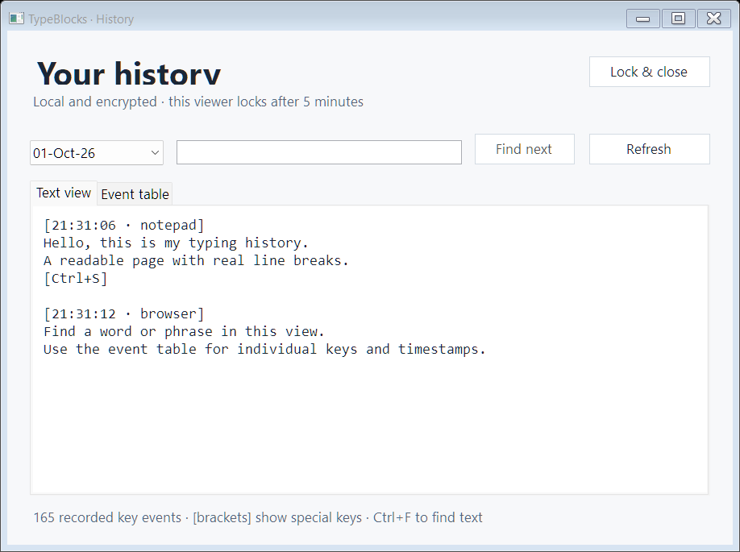
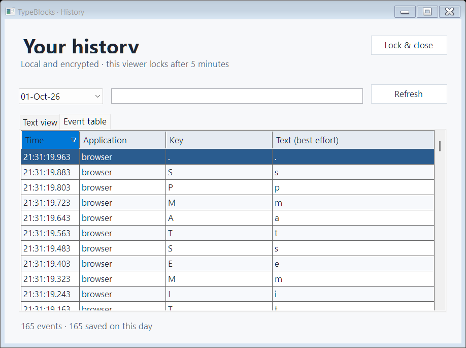

# TypeBlocks

**A second chance for text you already typed.**

A small Windows tray app that keeps a searchable, encrypted local history of your typing. When a draft disappears, a form resets, or you close a message too soon, TypeBlocks can help you find the words again.

Built as a personal utility by [Tilemachos Tragakis](https://github.com/RagDel).

> **Portfolio showcase.** This repository contains a product overview and synthetic demo screenshots. Application source code, executables, personal typing records, and the private development history are not published here.

*The actual app UI, rendered with synthetic test text. No personal typing history is shown.*

## What it does

| Feature | Everyday benefit |
| --- | --- |
| Readable text history | Browse a day's typing with line breaks and sections for application changes or long pauses. |
| Find words and phrases | Use **Ctrl+F** and **Find next** to search the selected day. |
| Detailed event view | Filter by application, key, or text; sort individual events and timestamps. |
| Password-protected history | Choose a password before capture starts; unlock it when you need to look back. |
| Quick capture controls | Use the visible tray icon or **Ctrl+Alt+F11** to pause and resume. Exclude entire applications. |
| Optional startup | Start at Windows sign-in; a paused state stays paused across restarts. |

The history viewer closes five minutes after opening or when the Windows session locks. Recording can continue while the history viewer is locked.

See the event table

*Synthetic events only.*

## Behind the app

Built with **C#, .NET 8, WinForms, and Win32**, using built-in .NET cryptography and no third-party packages. The project brings together native desktop integration, asynchronous batched storage, encryption, and a small searchable UI.

Each saved batch uses AES-256-GCM, with its key wrapped using RSA-3072 OAEP-SHA256. A public recording key allows capture while the private reading key remains password-encrypted. Password keys are derived with PBKDF2-SHA256.

The app stores data locally and has no network or cloud features. It records key events, timestamps, application process names, and best-effort translated characters. It does not collect screenshots, clipboard contents, or window titles.

## Privacy and responsible use

**Typed history can contain passwords, private messages, and other sensitive information.** TypeBlocks is intended for recovering your own typing on a device you control. Anyone whose input could be recorded must understand and explicitly consent to it. Never use it for covert monitoring or credential collection; misuse can expose sensitive data and violate other people's privacy.

- Password-field detection is incomplete, especially in browsers and custom controls. Pause capture or exclude sensitive applications before typing private information.
- Encryption protects stored files. It cannot protect an unlocked viewer, malicious software running as you, or a compromised Windows session.
- There is no forgotten-password recovery, and history has no automatic expiry.

## Scope and validation

Recovery is best effort. The app keeps an event history rather than reconstructing a finished document: cursor edits, pasted text, input methods, autocomplete, protected applications, and interruptions can leave gaps or inaccurate text.

The private project has **22 passing core tests** and a passing synthetic Windows/UI smoke test. Demo screenshots come from a temporary test vault with live recording disabled. These checks do not establish compatibility with every physical keyboard, layout, or application.
